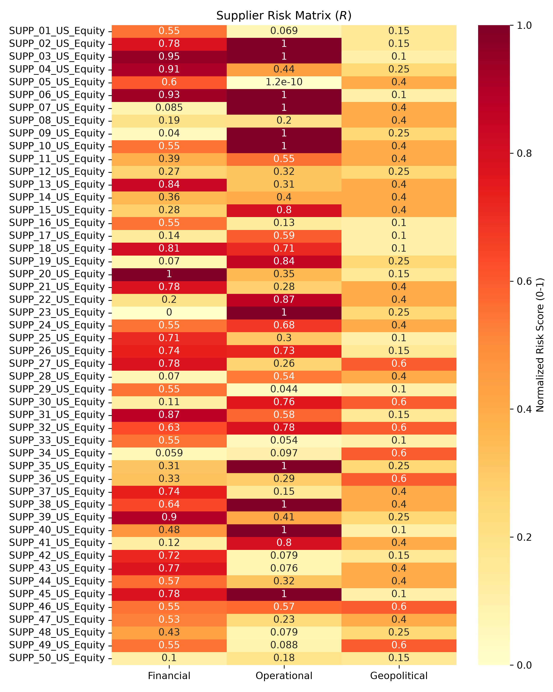
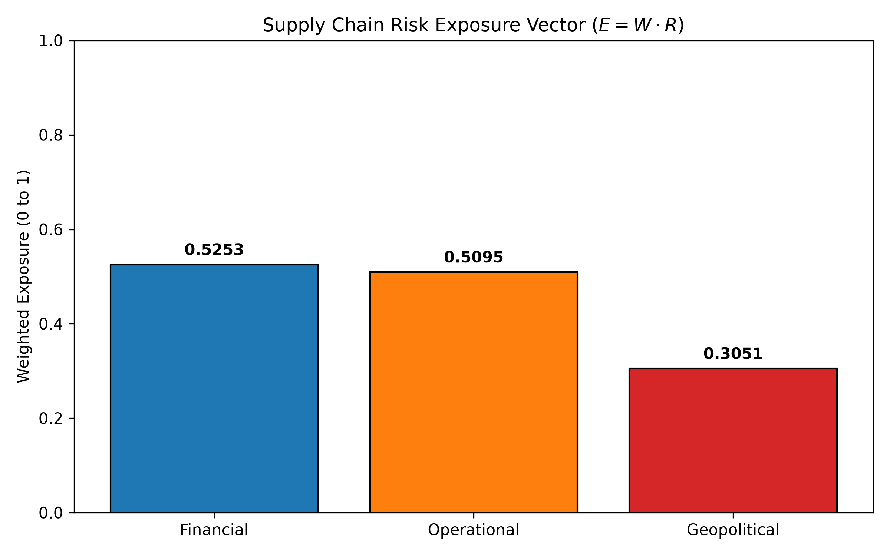

# Bloomberg Supply Chain Risk Matrix: Apple Inc. (AAPL)

## Project Overview
This repository contains a quantitative data engineering and linear algebra pipeline designed to evaluate Tier-1 supply chain risk. The model analyzes 20 of Apple Inc.'s top suppliers across three distinct risk dimensions: Financial, Operational, and Geopolitical.

**Data Governance Notice:** To strictly comply with Bloomberg's Terms of Service, all proprietary raw BDP extractions are blocked via `.gitignore` and secured locally. This repository utilizes a structurally identical synthetic dataset (`synthetic_data.csv`) to publicly demonstrate the data engineering and matrix operations. The executive insights derived from the real dataset are summarized below.

## Technologies & Tools Used
* **Data Extraction:** Bloomberg Terminal, Bloomberg Excel Add-in (BDP API)
* **Core Language:** Python 3
* **Data Engineering & Imputation:** `pandas`
* **Linear Algebra & Matrix Math:** `numpy`
* **Data Visualization:** `matplotlib`, `seaborn`

## Methodology & Data Pipeline
The dataset was constructed using real-time Bloomberg Data Point (BDP) API queries:
* **Financial Risk:** 1-Year Default Probability (`=BDP(A2, "BB_1YR_DEFAULT_PROB")`). Missing values were resolved using median imputation to prevent matrix operational failure.
* **Operational Risk:** ESG Score (`=BDP(A2, "ESG_SCORE")`). 
* **Geopolitical Risk:** Country of Domicile (`=BDP(A2, "CNTRY_OF_DOMICILE")`). Categorical countries were mapped to a quantitative macro-risk index (0.10 to 0.60).

**Aggressive Missing Data Penalization:**
Rather than using median imputation for missing ESG data, null values were imputed as `0`. This actively penalizes suppliers for a lack of sustainability transparency, converting a reporting gap into a measurable operational risk indicator. 

## The Mathematical Formulation
The risk model relies on NumPy matrix multiplication to compute weighted exposure, avoiding inefficient iterative loops. All risk dimensions are min-max normalized to a $[0, 1]$ scale.

* $W$: A $1 \times 20$ normalized vector representing Apple's revenue reliance on each supplier.
* $R$: A $20 \times 3$ matrix containing the normalized risk factors (Financial, Operational, Geopolitical) for each supplier.
* $K$: A $3 \times 1$ strategic weighting vector applied to the risk dimensions (40% Financial, 30% Operational, 30% Geopolitical).

**Exposure Vector Calculation:**
$$E = W \cdot R$$

**Final Vulnerability Scalar:**
$$V = E \cdot K$$

## Executive Findings: Real Apple Data vs. Synthetic Demonstration

### Real Apple Supply Chain Insights (Local Execution)
Execution on the proprietary Bloomberg dataset revealed a highly resilient financial network, but flagged operational opacity as the primary vulnerability.
* **Data Governance Action:** Penalized 3 real suppliers with 0 for missing `ESG_Score`.
* **Financial Risk Exposure:** 0.1007 *(Indicating highly solvent Tier-1 partners)*
* **Operational Risk Exposure:** 0.3779 *(The primary threat, driven by ESG opacity)*
* **Geopolitical Risk Exposure:** 0.2928 *(Reflecting geographic concentration in East Asia)*
* **Final Vulnerability Score ($V$):** **0.2415**

### Synthetic Public Execution 
Running the public repository pipeline on the synthetic dataset yields the following proof-of-concept output:
* **Data Governance Action:** Penalized 11 synthetic suppliers with 0 for missing `ESG_Score`. Imputed `1Y_Default_Prob` median of 0.027139.
* **Financial Risk Exposure:** 0.5253
* **Operational Risk Exposure:** 0.5095
* **Geopolitical Risk Exposure:** 0.3051
* **Final Vulnerability Score ($V$):** **0.4545**

## Outputs & Visualizations
The Python pipeline automatically generates the following visualizations based on the active dataset:

### Supplier Risk Matrix Heatmap ($R$)


### Final Exposure Vector ($E$)


## Execution Instructions
To run the synthetic data pipeline locally:

```bash
pip install pandas numpy matplotlib seaborn
python risk_matrix_pipeline.py
